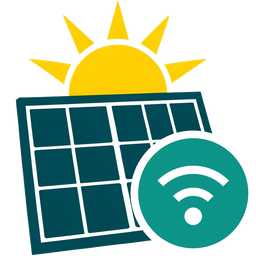

# Deye Bluetooth for Home Assistant

**Read and control a Deye hybrid inverter locally, through the Bluetooth console of its Wi-Fi/BLE logger.**
No cloud, no extra wiring, no Modbus adapter.

> [!WARNING]
> With *Allow writes* on, this integration can change every inverter setting, including grid protection and battery
> voltages, with no safety checks. Read [Writing to the inverter](#writing-to-the-inverter) first.

This is an independent project, not made by or affiliated with Deye.

## Features

- **Live data**: grid currents, powers and load every second, grid voltages and everything else every 15 s (configurable).
- **Every decoded register** as a sensor: PV, battery, BMS, grid, inverter, generator, energy counters, faults.
- **Every setting on the device page**: Time-of-Use programs, work mode, charge limits, solar sell, battery voltages and
  chemistry, generator, grid protection.
- **Grid-charge switch** and a **grid-present** binary sensor.
- **Discovered automatically** over Bluetooth, set up in the UI.
- **Several loggers** on one Home Assistant.
- **Read-only by default**: nothing is written until you turn on *Allow writes*.

## Compatibility

| Inverter | Status |
|---|---|
| SUN-15K-SG05LP3-EU-SM2 with logger `DYDA_WiBLE_1.6.2` | **Verified**: reads and writes, except the settings [listed below](#writing-to-the-inverter) |
| Other Deye 3-phase LV hybrids | Untested, likely to read correctly |
| Other Deye models (single-phase, HV) | Untested: registers may differ, a warning is logged |

Reports from other models are welcome, see [CONTRIBUTING](CONTRIBUTING.md).

## Requirements

- Home Assistant 2026.3 or newer.
- A Bluetooth adapter or an [ESPHome Bluetooth proxy](https://esphome.io/components/bluetooth_proxy.html) with an
  active connection within range of the logger. Signal quality matters more than anything else here.
- The Deye phone app closed: the logger accepts one Bluetooth connection at a time.

## Installation

### HACS

Or search for **Deye Bluetooth** in HACS, download it, and restart Home Assistant.

### Manually

Copy `custom_components/deye_bluetooth` into your `config/custom_components` folder and restart. **Keep a copy of
the old folder off the HA host before upgrading**: downgrading is a file swap plus a restart, and a file swap does
not restore the config entry's options. After restarting, check that the installed `manifest.json` version matches
the release you intended (HACS reads the version from the release tag, HA from this file).

## Setup

The logger shows up under **Settings → Devices & services** once it is in range. Otherwise use
**Add integration → Deye Bluetooth**.

Rated power and device type come from the inverter. Polling, write safety and the Bluetooth link are on the
options page (the integration's **Configure** button); every inverter and battery setting is a control under
**Configuration** on the device page.

<b>All options and their defaults</b>

| Section | Option | Default |
|---|---|---|
| Polling | Live interval (grid currents and powers, load; each change is a recorder row) | 1 s |
| | Poll interval (everything else) | 15 s |
| | Settings interval | 300 s |
| | Values / settings go unavailable after | 120 s / 900 s |
| | Alert after no answer (a Repairs issue; 0 = off) | 300 s |
| Writing | Allow writes | off |
| | Write attempts | 3 |
| Bluetooth link | Modbus address | 1 |
| | Registers per read (longer reads are split) | 16 |
| | Reply timeout, connect attempts | 10 s, 3 |
| | Write and notify characteristic UUIDs | see [protocol](docs/protocol.md); if the logger has other ones, the pair that answers is found and saved here |

The register map and the discovery UUID are in the code: the inverter cannot report the first, and Home Assistant
needs the second in `manifest.json`. **Check each setting against your inverter and battery manual before allowing
writes: the register ranges only fit the register, they do not protect anything.**

## Entities

The first logger gets the prefix `deye`, the second `deye_2`, and so on.

| Entity | Meaning |
|---|---|
| `sensor.deye_grid_power` | Grid power (W): import > 0, export < 0 |
| `sensor.deye_grid_phase_{a,b,c}_{current,voltage,power}` | Per phase (power in kW) |
| `sensor.deye_load_power` | Load (kW) |
| `sensor.deye_pv_power`, `sensor.deye_pv{1,2}_power` | PV (W) |
| `sensor.deye_battery_{soc,power,capacity}` | Battery: discharge > 0, charge < 0 |
| `sensor.deye_{grid_import,grid_export,load,pv}_energy` | Totals (kWh), for the Energy dashboard |
| `binary_sensor.deye_grid` | The grid is present: the relay is closed, or a phase is at least 100 V (fixed) |
| `switch.deye_grid_charge` | Battery charges from the grid, see [below](#grid-charge-switch) |
| `sensor.deye_inverter_<key>` | Every decoded register. The ones that repeat a setting or a summary sensor above are **disabled by default**, e.g. `sensor.deye_inverter_grid_power_l1` or `sensor.deye_inverter_work_mode`: they show the same register again. To use one, open the device page, choose *show disabled entities* and enable it |
| `number.`, `select.`, `time.`, `switch.deye_inverter_<key>` | The settings |

The controls cover every setting of the register map, grid protection and battery chemistry included. Bit-field registers
(special functions, AC coupling, MPPT scanning) appear as raw numbers. Readings, identity and the inverter clock are not
controls, and neither is the Modbus address, because a new one ends the link.

Power limits follow the rated power the inverter reports. All the other ranges only fit the register: they do not
protect anything. Since 1.2.0 they are fixed (e.g. low SoC 0–100 %, current 0–2000 A, zero export 0–10000 W) and
the grid-present threshold is a fixed 100 V — the old configurable *Limits* options are gone. **Check each value
against your inverter and battery manual before allowing writes.**

### Grid-charge switch

`switch.deye_grid_charge` writes seven registers and nothing else: the grid flag of all six Time-of-Use programs
and the inverter's Grid Charge enable.

- **On** sets the flag on every program and enables Grid Charge. Each program charges up to its own SoC, so set
  `number.deye_inverter_program_<n>_soc` to how far the battery should charge.
- **Off** clears the flag on every program and disables Grid Charge. The battery still covers the house only down to
  each program's SoC.

The switch never changes a program's SoC. It does overwrite the grid flags: if only some of your programs charge from
the grid, the first toggle makes all six the same. A program's generator flag stays as it is. The switch shows on when
Grid Charge and program 1's flag are both set.

## Actions

| Action | Fields |
|---|---|
| `deye_bluetooth.read_registers` | `address`, `count` (1–125), returns the raw words |
| `deye_bluetooth.write_register` | `address`, `value` (a number or a list). Admin users only |

With more than one logger, both also need `config_entry_id`.

## Writing to the inverter

> [!CAUTION]
> **You use this at your own risk.** Writes change a device connected to mains and a battery, and there are no safety
> checks: the integration writes whatever value you give it, inside the register's range. The authors accept no liability
> for damage, injury, fines or lost warranty.

**What a wrong value can do:**

- **Grid protection** (voltage and frequency limits, reconnection time, grid standard): the inverter may stay connected
  to a faulty grid or feed a line that should be dead, which can endanger people working on it. It can also break your
  grid operator's rules and void the certification your connection depends on.
- **Battery settings** (chemistry, BMS type, absorption, float and equalization voltages, shutdown limits): the battery can
  overcharge, deep-discharge or overheat, with a risk of permanent damage or fire.
- **Limits and modes** (currents, export, generator, smart load, AC coupling, raw words): cables, breakers and connected
  equipment can be overloaded, and the house can lose power.

**What protects you, and what does not:**

- Writes are off by default. Nothing is written until you turn on *Allow writes*.
- Only changed registers are written, because they live in EEPROM. Each one is read back, and a mismatch is an error. This
  confirms the inverter stored the value, not that the value is safe.
- `write_register` is for admin users only. **The controls are not:** with *Allow writes* on, any Home Assistant user,
  automation or dashboard that can change entities can change these settings too.
- Registers and scales come from a published map of the 3-phase LV hybrids. On other models the same address can mean
  something else.

**Not tried on real hardware:** the settings added in 1.2.0, which are grid protection and grid standard, battery chemistry
and voltages, generator, smart load, AC coupling, peak shaving and the raw words. Note the value before changing it, and
check the result on your inverter's display.

Check every value against your inverter and battery manuals and your grid operator's requirements. Changing grid protection
may need a qualified electrician or your grid operator's approval.

## Troubleshooting

- **Not discovered**: close the Deye app, and check that the adapter sees the logger under the Bluetooth integration.
- **Keeps dropping**: move the adapter or a proxy closer. Weak signal is the usual cause. After a failed connection the
  polls wait 2, 4, 8 … up to 60 s before they connect again; a logger that is out of range is looked for at every poll.
  Reads and writes from the actions do not wait.
- **"Not answering over Bluetooth" in Repairs**: the logger has not answered for the *Alert after no answer* option
  (5 min by default). Close the Deye app and check the signal first. The logger has no pairing or password and takes one
  connection at a time, so if neither helps, another device in range may hold it: it can read and change the
  inverter's settings while it does. Restarting the logger drops that connection. The issue goes away by itself once
  the logger answers.
- **A register is refused**: the inverter answered with a Modbus exception. The action fails with that message and the
  link stays up; the values of that block age out as usual.
- **Grid-charge switch fails**: turn on *Allow writes*.
- **Debug logs**: add `custom_components.deye_bluetooth: debug` under `logger:`.
- **Reporting**: attach the device's diagnostics. They leave out the serial number and Bluetooth address.

## Credits

The logger protocol was first documented by [PetePeter/deye-bluetooth](https://github.com/PetePeter/deye-bluetooth)
(MIT), the register map follows [ha-solarman](https://github.com/davidrapan/ha-solarman). See [docs/protocol.md](docs/protocol.md).

## License

[MIT](LICENSE)
